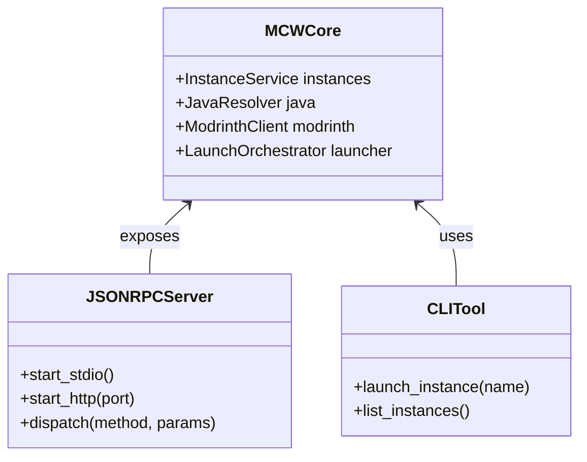

# Kiến trúc kỹ thuật MCW Launcher Core (`mcw_core`) 🏛️

**MCW Core** là thư viện Python độc lập, đóng vai trò là khối não bộ xử lý ngầm (headless engine) cho toàn bộ hệ sinh thái MCW Launcher.

---

## 🧩 Mô hình phân tầng kiến trúc

Dự án áp dụng nguyên lý tách biệt mối bận tâm (**Separation of Concerns**), giữ toàn bộ giao diện người dùng (GUI) nằm ngoài nhân Core:



---

## 🔌 Giao tiếp liên tiến trình (IPC) với JSON-RPC 2.0

Để bất kỳ ứng dụng nào (viết bằng Electron, Qt, Web, hay C#) đều có thể điều khiển Core, MCW Core cung cấp giao thức **JSON-RPC 2.0** theo 2 hình thức:

1. **Standard I/O (stdio):** Thích hợp khi GUI khởi chạy tiến trình con của Core.
2. **HTTP Server Daemon:** Mở cổng cục bộ (ví dụ `http://127.0.0.1:38475`) để gọi qua REST/RPC.

### Ví dụ định dạng Request & Response:

```json
// Request: Lấy danh sách instances
{
  "jsonrpc": "2.0",
  "method": "instance.list",
  "params": {},
  "id": 101
}

// Response:
{
  "jsonrpc": "2.0",
  "result": [
    {
      "name": "Fabric-1.21",
      "version": "1.21.1",
      "loader": "fabric",
      "loader_version": "0.16.5"
    }
  ],
  "id": 101
}
```

---

## 📦 Cài đặt và phân phối

Gói thư viện được đóng gói thành định dạng Wheel chuẩn của Python (`.whl`) và phát hành trên GitHub Releases:

```bash
# Cài đặt qua file wheel cục bộ
python -m pip install ./mcw_core-1.8.0-py3-none-any.whl

# Chạy daemon thử nghiệm
mcw-core-rpc --http --port 38475
```
