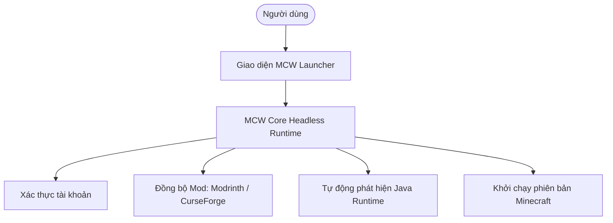

# MCW Launcher 🚀

**MCW Launcher** là dự án Minecraft launcher hiện đại được thiết kế với mục tiêu mang lại trải nghiệm tinh gọn, tốc độ khởi động nhanh và quy trình cài đặt modpack tối ưu nhất cho cộng đồng game thủ.

Trang chủ chính thức của dự án hiện được triển khai tại: [mcwlauncher.pages.dev](https://mcwlauncher.pages.dev/)

---

## 🌟 Điểm nổi bật của MCW Launcher

### 1. Quản lý bản cài đặt (Instances) linh hoạt
- Tạo nhiều phiên bản Minecraft độc lập mà không bị xung đột mod hay thiết lập.
- Tự động phát hiện và cài đặt các loader phổ biến: **Fabric, Forge, NeoForge, Quilt**.
- Hỗ trợ xuất / nhập nhanh instance dưới dạng file nén.

### 2. Tích hợp kho Mod phong phú
- Tìm kiếm và tải mod trực tiếp từ **Modrinth** và **CurseForge** mà không cần mở trình duyệt.
- Tự động kiểm tra độ tương thích giữa phiên bản game và các thư viện phụ thuộc (dependencies).

### 3. Tối ưu hóa Java và hiệu năng
- Nhận diện các phiên bản Java (Java 8, 17, 21) có sẵn trên máy tính người dùng.
- Tự động áp dụng các tham số JVM tối ưu cho bộ thu gom rác (Garbage Collector như ZGC, G1GC).

---

> [!TIP]
> Toàn bộ logic xử lý ngầm của MCW Launcher được bóc tách vào thư viện **MCW Core** (`mcw_core`), cho phép tái sử dụng hoặc tích hợp vào các công cụ CLI khác.
