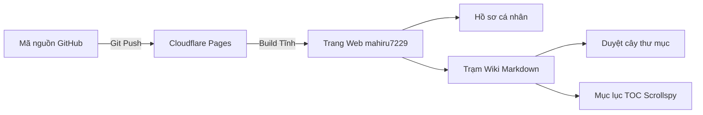

# Showcase cú pháp Markdown & Công nghệ hiển thị 🌟

Tài liệu này kiểm chứng toàn bộ khả năng biên dịch của Wiki.

---

## 1. Callout Alerts theo chuẩn GitHub

> [!NOTE]
> Khối thông tin (**NOTE**) dùng để cung cấp giải thích mở rộng.

> [!TIP]
> Khối mẹo (**TIP**) hướng dẫn cách tối ưu công việc.

> [!IMPORTANT]
> Khối quan trọng (**IMPORTANT**) những lưu ý bắt buộc phải nhớ.

> [!WARNING]
> Khối cảnh báo (**WARNING**) nhắc nhở tránh lỗi phát sinh.

> [!CAUTION]
> Khối báo động (**CAUTION**) hành động nguy hiểm có thể gây hỏng hóc!

---

## 2. Sơ đồ tương tác với Mermaid

Hệ thống tự động biên dịch sơ đồ động từ mã mermaid thành SVG sắc nét:

---

## 3. Công thức toán học KaTeX

Công thức nội dòng: $E = mc^2$ và $\int_a^b f(x)dx = F(b) - F(a)$.

Khối công thức toán:

$$f(x) = \frac{1}{\sigma \sqrt{2\pi}} e^{-\frac{1}{2}\left(\frac{x-\mu}{\sigma}\right)^2}$$

Tổng hữu hạn:

$$\sum_{i=1}^{n} i^2 = \frac{n(n+1)(2n+1)}{6}$$

---

## 4. Bảng biểu và Danh sách tác vụ

| Chuyên mục | Định dạng | Trạng thái |
| :--- | :--- | :---: |
| **Cây thư mục** | JSON Manifest / Folder Tree | ✅ Sẵn sàng |
| **Mục lục TOC** | H1 - H4 với Scrollspy | ✅ Hoạt động |
| **Tô màu cú pháp** | Highlight.js | ✅ Đa ngôn ngữ |
| **Toán học** | KaTeX client-side | ✅ Sắc nét |
| **Biểu đồ** | Mermaid.js | ✅ SVG động |

- [x] Thiết kế giao diện Wiki tĩnh chuyên nghiệp
- [x] Bỏ nút upload thủ công, chuyển sang hook tự động từ thư mục `wiki/`
- [x] Phân chia tài liệu theo cấu trúc thư mục rõ ràng
- [x] Hỗ trợ triển khai mượt mà trên Cloudflare Pages & GitHub Pages
